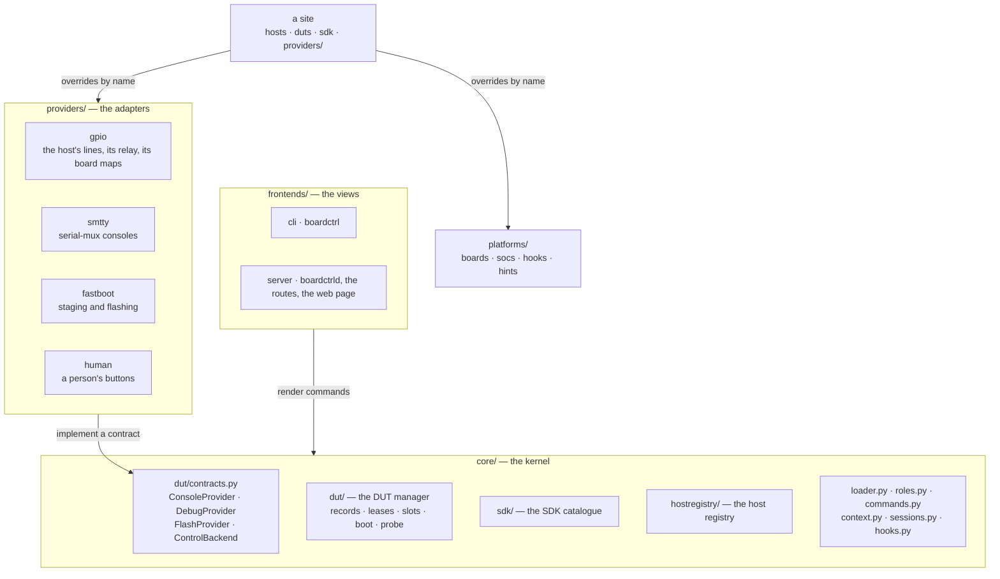
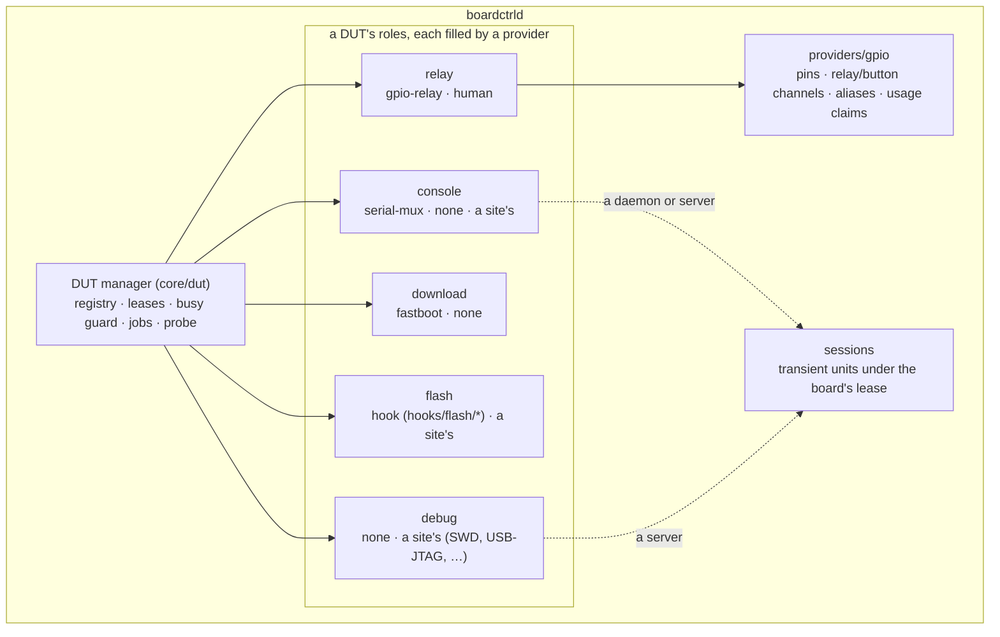
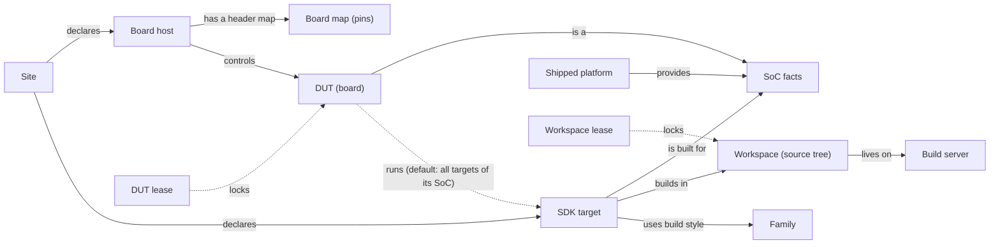
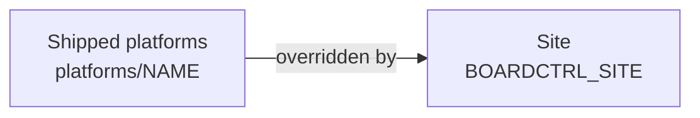

# Architecture

boardctrl is an atomic, scriptable layer over three kinds of resources — boards (DUTs), the board
hosts that control them, and SDK source trees on build servers. Every capability is one
command that works the same for a human at a terminal, an agent (`--json`), an HTTP client
and the web console. This page describes the internals; start with the [README](../README.md) for an overview.

## Layers



| Layer | Is | May import |
|---|---|---|
| `core/` | the kernel: what a board host is, independent of any tool | `core/` only — no provider, no frontend, no HTTP framework |
| `providers/<name>/` | an adapter: one external system bound to a role | `core/`, the platform files, none of another provider's files |
| `frontends/` | a view: the CLI, the daemon, the routes a browser needs | `core/`, `providers/` |
| `platforms/`, the site | data: hardware knowledge and deployment facts | — |

`scripts/check-architecture.py` (with `architecture.json`) enforces the first three; `core/` importing
`fastapi`, a provider or a frontend fails the check.

| Model | Here |
|---|---|
| DDD aggregate | the DUT — its record, lease, slot, boot recipe and probe; the SDK catalogue; the host registry |
| ports and adapters | a DUT's five roles are ports (`core/dut/contracts.py`); an adapter implements one |
| ECS | a DUT is the entity, each line of its `services:` a component (role → provider), a provider the system that acts on it |
| kernel and drivers | the kernel offers subsystems, services and the loader; a driver registers at setup, and one that fails does not take the host down |
| device tree | `platforms/<vendor>/` — hardware facts, layered and overridden by the site |
| MVP / MVVM | one `CommandSpec` is the view-model behind REST, AI tools, the CLI and the page |

Every host feature is a `CommandSpec`; each spec becomes a REST route, an AI tool, a web-console
command and a CLI subcommand at once (`core/cmdspec.py`). SDK work that touches source trees is
client-side: the CLI pipes a stdlib-only helper to the build server over ssh, so nothing is
installed there.

## A board host

A board host controls boards: it resets them, carries their consoles, puts images on them and, where the
hardware allows, debugs them. Each of those is a **role**, and a role is filled by a provider the board's
record names — the device-model idea, with the DUT as the device and providers as its drivers. The DUT
manager is the kernel's: a host has one because boardctrl controls boards.



```yaml
# A DUT record names its providers; a record without `services:` reads as the built-ins
services:
  relay:    {provider: gpio-relay, reset: {pin: J40:11}}
  console:  {provider: serial-mux, alias: tty-a}
  download: {provider: fastboot, usb: "usb:2-1.4"}
  flash:    {provider: hook}
  debug:    {provider: my-swd, target: probe0}    # a site's
```

| Role | Contract | Commands | Providers |
|---|---|---|---|
| `relay` | `dut/contracts.py: ControlBackend` | `boardctrl dut reset`, `relay`, `button` | `gpio-relay` (providers/gpio), `human` (providers/human) |
| `console` | `dut/contracts.py: ConsoleProvider` | `boardctrl dut console`, `pipe`, `log` | `serial-mux` (providers/smtty), `none` (kernel) |
| `download` | `dut/boot.py` over the provider | `boardctrl dut stage`, `present`, `boot` | `fastboot` (providers/fastboot), `none` (kernel) |
| `flash` | `dut/contracts.py: FlashProvider` | `boardctrl dut flash` | `hook` (kernel: `hooks/flash/*`); a site adds writers |
| `debug` | `dut/contracts.py: DebugProvider` | `boardctrl debug …` | `none` (kernel); a site adds the real ones |

A provider says what it offers (`debug` reports `halt`, `run`, `step`, `regs`, `trace`, `gdb`) and describes its own
settings, so the API, the CLI and the page offer exactly that. A provider whose server outlives one command — a
console daemon, a debug adapter, a trace bridge — runs as a **session**: a transient systemd unit recorded per DUT
and role, started and stopped through `boardctrl`, and reaped when the board's lease ends, so nobody inherits a
server pointed at someone else's breakpoint.

**The GPIO provider** hands out the header's lines three ways: channels (relay, button, raw level, behind the
timeout guard), aliases (`DUT3/reset`), and **usage claims** — a feature claims the pins it needs
(`swd: swclk=J40:11, swdio=J40:13`) and drives them directly, for timing a thread hop would spoil. A claimed pin
cannot be configured, aliased or driven by anyone else.

**A site's providers** carry hardware nobody bought a driver for: `providers/<name>/provider.py` with
`setup(ctx, api[, config])` registers implementations, services, commands and routes at host start (a site that
still spells it `modules/<name>/module.py` is read too). One that fails to load is reported as degraded and never
takes the host with it; code lives in the site layers, never in this repository unless it is the kernel's own.

The serial console service is where a board host starts: every serial console is a **slot**
(`dut/slots.py`), with a serial-mux console of its own as soon as its adapter is plugged in and
before anything else is known. The DUT manager attaches the rest to slots as it learns it: the reset
line, the download port and the board identity (the DUT). Slots outlive boards, and remember which
lines, ports and boards they had: probe tries those lines first, `boardctrl dut refresh` re-reads a board
swapped into a slot, and a DUT can be named by its slot (`<host>/s3`) wherever its name works.

A board's lines are aliases on the relay controller (`<dut>/reset`, `<dut>/fdl`, and any other
line a site names `<dut>/<role>`), so a person, a script or a front end can work one line by hand
with `boardctrl relay`/`boardctrl button` while the DUT manager uses the same lines for resets.

boardlab, the lab-wide registry and front end, drives board hosts through this CLI only (`--json
--stateless`): its `bsp` module maps its backend contract onto these roles — relay to `boardctrl dut
reset`/`confirm` and to `boardctrl relay`/`boardctrl button` for single lines, download to `boardctrl dut
stage`/`present`/`boot`, consoles to `boardctrl dut pipe` (or the session stream of a console provider that is not
serial-mux), debug to `boardctrl debug …` and its session stream, inventory and discovery to `boardctrl dut list`
and `boardctrl probe`, news to `boardctrl watch --registry`.

## Concepts



## Configuration layers

A host's data is merged from the shipped platforms and the site, in that order (`core/site.py`), with a
file overridden by the same path in a later layer and SoC facts deep-merged key by key. Code never
refers to a vendor or an installation; it asks for the merged view of a kind of data
(`layered("socs")`, `layered("sdk")`, …). The layers and their file formats are described in
[configuration.md](configuration.md).



`.bspignore` and the other optional files of a site are listed in [configuration.md](configuration.md).

## Resources

| Resource | Identified by | Defined in | Exclusive access |
|---|---|---|---|
| Build server | id (ssh login, job environment) | `SITE/sdk/servers/` | — |
| Family | build style and artifact roles | `SITE/sdk/families/` | — |
| Workspace | one checkout on one server | `SITE/sdk/workspaces/`, or implicit per target | Workspace lease, build lock, jobs in `TREE/.bsp/` |
| SDK target | workspace + family + SoC + artifacts + boot recipes | `SITE/sdk/instances/` | Through its workspace |
| SoC facts | SoC id | `socs/<soc>/soc.yaml` in the platforms and the site (deep-merged) | — |
| Board host | host id | `SITE/hosts/`, `SITE/remotes.json` | — |
| DUT | DUT id: host, SoC, control backend, USB path, console | Registered on the host (`probe`, `bind`, `add`) or `SITE/duts/` | DUT lease on its host |
| Reset / download-mode line | aliases `<dut>/reset`, `<dut>/fdl` | Registered by the DUT manager with the gpio service | Through the DUT |
| Slot | `s<N>` on its host (`<host>/s<N>`): one serial console, by its physical USB port | Found on the host (`boardctrl slot list`) | Through the DUT in it |
| Console | serial-mux alias, systemd unit `boardctrl-console-<alias>` | serial-mux on the host | Through the DUT (writes) |
| Build artifact | SHA-256 | Host cache `STATE_DIR/dut/artifacts/` | — |

Aliases let commands pass straight through the layers: `boardctrl dut reset board-1` reaches the dut
manager, its control backend calls `button click board-1/reset`, and the gpio service resolves that
to a header pin.

## SoC facts

A SoC file tells boardctrl how to recognise the SoC and its download mode, and how to identify a
board during probing; [porting.md](porting.md#a-new-soc) documents every key. Probe uses
`fingerprint` to name the SoC and the generic `hooks/probe/identify` hook to run the `identify`
sequence. `enter-fdl` steps and the human reset backend use `download_mode`, unless a DUT
overrides it with `control.fdl.expect`.

## Extension points

| To add | Do this | Interface |
|---|---|---|
| A board host | `SITE/hosts/<id>.yaml`, `SITE/deploy/<id>.env`, an entry in `remotes.json`; `deploy/deploy.sh <id>` | Host configuration |
| A board | `boardctrl probe`, `boardctrl dut bind`, or a file in `SITE/duts/` | DUT spec |
| A SoC | `socs/<soc>/soc.yaml` in a shipped platform; probe images in the site | SoC facts |
| A probe mechanism | Replace `hooks/probe/{consoles,usb-devices,identify}` | JSON hook contract |
| A reset mechanism | Subclass `ControlBackend`, register with `@CONTROL_BACKENDS.register` | `reset(log, ready)`, `enter_fdl(log, ready)`, `setup()` |
| A boot or flash procedure | Recipe steps in the SDK target; `hook` steps call `hooks/flash/<name>` | [Step reference](sdk.md#boot-recipe-steps) |
| An SDK | `SITE/sdk/instances/<id>.yaml`, plus a family for a new build style | YAML |
| A build style | A runner in `Instance.build_command` (`make`, `envsetup`, `script` exist) | Runner |
| GPIO hardware | A `GpioBackend` (sysfs, gpiod and mock exist), wrapped by `GuardedBackend` | `set_output`, `set_input`, `status`, `free` |
| A transport to hosts | A transport in the remote's chain (`HttpTransport`, `SshTransport` exist) | `request()`, `stream()` |
| Agent knowledge | `hints/*.md` in a platform or the site | Free text |
| A host feature | A `Module` that publishes `CommandSpec`s: REST, CLI, AI tools and web console follow | `core/module.py` |

Long operations (boots, probes, human-assisted resets) run as background jobs
(`core/jobs.py`) that report progress lines; changes are published on an event bus that feeds
`boardctrl watch` and the web console.

## Shared source trees

One source tree can build several targets, such as an upstream kernel tree built for two SoCs.
Mutual exclusion therefore follows the tree, not the target: a **workspace** is the tree, and its
lease, task branch, build lock and job list live in `TREE/.bsp/`. An **SDK target** is a build
configuration within a workspace. Acquiring any target leases the whole workspace; the holder can
then build and boot every target in it, and everyone else gets a conflict naming the holder,
task and target. A target without `workspace:` owns an implicit workspace.

## Concurrency

- **Hosts.** The CLI talks to every reachable host, or only to the local one when it runs on a
  board host. Board commands are routed to the host that owns the board; `probe` and `dut list`
  query all hosts in parallel.
- **Boards.** Each board has its own USB path, console and reset alias. Leases and a per-board
  busy guard serialise access.
- **SDKs.** Each workspace has its own lease, branch, build lock and jobs, so different
  workspaces build in parallel. Boot refuses SDK targets built for a different SoC.
- **People and agents.** DUT and workspace leases carry tokens; `--stateless` with explicit
  tokens lets several agents share one machine and user account.

## Errors

Every failure has a `code`, a `message`, a `hint` naming the next step, and machine-readable
`details`; see [cli.md](cli.md#output-and-errors). Hardware quirks are documented by the platform
that knows the hardware (for example `platforms/spacemit/README.md`).
